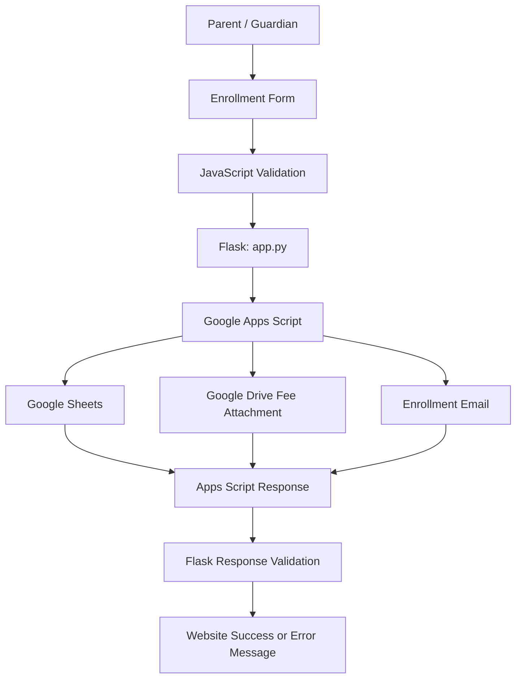

# Zinah Christian Academy (ZCA) Enrollment System

<div align="center">

**School Information Website and Online Student Enrollment System**


</div>

## About the Project

The Zinah Christian Academy (ZCA) Enrollment System is a school website designed to present school information and provide an online enrollment form for prospective students.

The website includes information about school programs, curriculum, school uniforms, school events, class schedules, attendance policies, and other school-related details. Its online enrollment form collects student information, contact details, family information, previous education, and enrollment preferences.

The enrollment workflow uses Google Apps Script to process submitted form data, save configured enrollment information to Google Sheets, and send an email containing school fees and enrollment requirements.

This project was developed during the second semester of academic studies, before relational database management had been covered in class. Google-based services were therefore used for the enrollment workflow instead of a conventional SQL database.

## Table of Contents

- [Features](#features)
- [Screenshots](#screenshots)
- [Technologies Used](#technologies-used)
- [Project Structure](#project-structure)
- [How to Run the HTML Files Directly](#how-to-run-the-html-files-directly)
- [How to Run Using Flask](#how-to-run-using-flask)
- [Enrollment Submission Workflow](#enrollment-submission-workflow)
- [Google Apps Script Configuration](#google-apps-script-configuration)
- [Troubleshooting](#troubleshooting)
- [Security and Privacy](#security-and-privacy)
- [Future Improvements](#future-improvements)

## Features

- School homepage and school information pages
- Programs and curriculum information
- School uniform information
- School events and calendar
- Class schedules and attendance policies
- Multi-step online student enrollment form
- Form validation and submission confirmation
- Student, family, contact, and educational information collection
- Flask server for local website hosting and enrollment request forwarding
- Google Apps Script integration for enrollment processing
- Google Sheets integration for enrollment records
- Automated email with school fees and enrollment requirements, when the Google-side workflow completes successfully
- Enrollment form printing
- Website image assets and styled page layouts

## Screenshots

The screenshots below are stored in the `docs/screenshot/` directory. The image paths use the filenames provided for this project.

### 1. Homepage and School Information

**Homepage**


**School Information**


**School Information — Additional View**


### 2. Programs, Curriculum, and Uniform

**Programs**


**Curriculum**


**School Uniform**


### 3. Events and Calendar

**School Events**


**School Calendar**


### 4. Class Schedule and Attendance Policy

**Attendance Policy**


**Class Schedule**


**Class Schedule — Additional View**


**Class Schedule — Additional View 2**


### 5. Enrollment Form

**Enrollment Form**


**Enrollment Form — Additional View**


**Enrollment Form Before Submission**


### 6. Enrollment Email

**Confirmed Enrollment Email**


> **Screenshot privacy:** Before publishing the repository, ensure that screenshots do not expose real students' private information, personal contact details, or confidential enrollment records. Use dummy information or redact sensitive details.

## Technologies Used

| Technology | Purpose |
|---|---|
| HTML5 | Website page structure and enrollment form |
| CSS3 | Website layout, styling, and responsive presentation |
| JavaScript | Form validation, page interactions, navigation, and submission handling |
| Python | Server-side programming |
| Flask | Local web server and enrollment request proxy |
| Requests | Sends enrollment form data from Flask to Google Apps Script |
| Google Apps Script | Processes enrollment submissions and runs the configured Google-side workflow |
| Google Sheets | Stores enrollment records through Apps Script |
| Google Drive | Stores fee attachment files used by the script |
| MailApp | Sends enrollment-related email from Apps Script |
| SweetAlert2 | Confirmation, loading, success, and error dialogs |
| Leaflet | Interactive map functionality, where configured |
| Google Fonts | Website typography |

## Project Structure

```text
Enrollment test/
│
├── app.py
├── index.html
├── enrollment.html
├── class-policy.html
├── script.js
├── style.css
│
├── images/
│   └── ... website images and other assets ...
│
├── docs/
│   └── screenshot/
│       ├── attendance-policy.png
│       ├── before-submission-enrollment-form.png
│       ├── calendar.png
│       ├── class schedule.png
│       ├── class-schedule1.png
│       ├── class-schedule2.png
│       ├── confirmed-enrollment-email.png
│       ├── curriculum.png
│       ├── enrollment-form.png
│       ├── enrollment-form1.png
│       ├── events.png
│       ├── homepage.png
│       ├── programs.png
│       ├── school-information.png
│       ├── school-information1.png
│       └── uniform.png
│
└── README.md
```

This is the main project structure. Additional assets and configuration files may be present.

## How to Run the HTML Files Directly

You can open the HTML files directly in a web browser without installing Python or Flask. This is useful for viewing the website interface and static content.

### Method 1: Open the HTML file

1. Open the project folder.
2. Locate `index.html`.
3. Double-click `index.html`.
4. Your default web browser should open the homepage.
5. Use the navigation menu to explore the website.

You can also open individual pages:

- `index.html` — homepage
- `enrollment.html` — online enrollment form
- `class-policy.html` — class schedules and attendance policies

### Method 2: Use Visual Studio Code and Live Server

1. Open Visual Studio Code.
2. Select **File → Open Folder**.
3. Select your project folder.
4. Open `index.html`.
5. If the Live Server extension is installed, right-click the file.
6. Select **Open with Live Server**.

Live Server usually opens the site at an address such as `http://127.0.0.1:5500/`. The port may differ depending on your configuration.

### Important limitation

Opening the HTML files directly or using Live Server allows you to preview the website, but the enrollment submission workflow may not work.

The current submission workflow uses Flask's `/submit-enrollment` endpoint to forward form data to Google Apps Script. If you open the website through Live Server or directly from the filesystem, that Flask endpoint is not available at the same origin.

For full enrollment submission testing, use the Flask method below.

## How to Run Using Flask

Flask serves the website and provides the `/submit-enrollment` endpoint used to forward enrollment data to Google Apps Script.

### Requirements

- Python 3.x
- A modern web browser
- Internet access
- A deployed Google Apps Script web app with appropriate permissions

### Step 1: Open the project folder

Open the project in Visual Studio Code, or open PowerShell and navigate to your project folder.

Example:

```powershell
cd "C:\Users\iah\Desktop\SCHOOL\HTML\Enrollment test"
```

If your project is stored elsewhere, use its actual path.

### Step 2: Create a virtual environment

Run:

```powershell
py -m venv .venv
```

### Step 3: Activate the virtual environment

For Windows PowerShell:

```powershell
.\.venv\Scripts\Activate.ps1
```

For Windows Command Prompt:

```bat
.venv\Scripts\activate.bat
```

When the environment is active, your terminal prompt should show `(.venv)`.

### Step 4: Install dependencies

Run:

```powershell
py -m pip install flask requests
```

### Step 5: Start the server

Run:

```powershell
py app.py
```

If Flask starts successfully, the terminal should display an address similar to:

```text
* Running on http://127.0.0.1:5000
```

Keep the terminal open while using the website.

### Step 6: Open the website

Open your browser and visit:

**Homepage:** http://127.0.0.1:5000/

**Enrollment Form:** http://127.0.0.1:5000/enrollment.html

Use the Flask-served address on port `5000` when testing enrollment submissions. Do not use the Live Server address for this workflow unless you have configured a proxy to Flask.

### Step 7: Stop the server

When finished, return to the terminal and press **Ctrl + C**.

> **Development warning:** Flask's built-in server and debug mode are intended for local development. Do not expose the development server directly to the public internet or use it as-is for production hosting.

## Enrollment Submission Workflow

The enrollment system uses the following process:

1. A parent or guardian completes the enrollment form.
2. JavaScript validates the form and asks the user to confirm submission.
3. The browser sends enrollment data to Flask through `POST /submit-enrollment`.
4. Flask forwards the data to the deployed Google Apps Script web app.
5. Apps Script appends the configured enrollment information to Google Sheets.
6. Apps Script looks up the fee attachment for the selected grade level in Google Drive.
7. Apps Script sends the email containing school fees and enrollment requirements.
8. Apps Script returns a response to Flask.
9. Flask validates the upstream HTTP response and JSON result.
10. The website displays the appropriate success or error message.

### System architecture



### Important submission behavior

- The browser submits data to Flask, not directly to Google Apps Script.
- Flask forwards the enrollment fields to the deployed `/exec` endpoint.
- Apps Script should return JSON indicating whether its operations succeeded.
- Flask should validate both the HTTP status and the JSON `success` field before returning success.
- An HTTP response alone does not prove that the enrollment was saved or that the email was sent.
- If the spreadsheet row is saved but email sending fails, the row may remain in the spreadsheet. Avoid repeated test submissions to prevent duplicate records.

## Google Apps Script Configuration

The Google Apps Script project is maintained separately from the website files.

The current workflow uses a `doPost(e)` function to receive enrollment data, append selected fields to a spreadsheet tab named `Sheet1`, retrieve a grade-specific fee image from Google Drive, and send an email using `MailApp`.

### Configuration checklist

1. Open the correct Google Apps Script project.
2. Verify that `doPost(e)` and its helper functions are saved.
3. Confirm that the target spreadsheet contains a tab named `Sheet1`.
4. Verify that the configured Drive folder contains the required fee files.
5. Confirm that Apps Script has permission to access Sheets, Drive, and Mail.
6. Open **Deploy → Manage deployments**.
7. Verify the web app deployment and its access permissions.
8. Deploy a new version after code changes when required by the deployment configuration.
9. Ensure that the `/exec` URL in `app.py` matches the deployed web app URL.
10. Check **Executions** in Apps Script when troubleshooting errors.

### Fee attachment mapping

The current script is configured for the following grade labels and filenames:

| Grade level | Expected attachment filename |
|---|---|
| Pre-Kinder | `Pre-Kinder_SY2026-2027_Fees.png` |
| Kinder | `Kinder_SY2026-2027_Fees.png` |
| Grade 1 | `Grade 1_SY2026-2027_Fees.png` |
| Grade 2 | `Grade 2_SY2026-2027_Fees.png` |
| Grade 3 | `Grade 3_SY2026-2027_Fees.png` |
| Grade 4 | `Grade 4_SY2026-2027_Fees.png` |
| Grade 5 | `Grade 5_SY2026-2027_Fees.png` |
| Grade 6 | `Grade 6_SY2026-2027_Fees.png` |

The selected grade label and attachment filename must match the mapping in the script. Update the mapping when the school year or fee documents change.

## Troubleshooting

### `405 Method Not Allowed`

- Confirm that `app.py` defines `/submit-enrollment` with `methods=["POST"]`.
- Make sure the route is registered before any catch-all route.
- Submit the form from the Flask-served website on port `5000`.

### `502 Bad Gateway`

- Verify that Flask is running.
- Check the Google Apps Script `/exec` URL in `app.py`.
- Check the Apps Script deployment access permissions.
- Inspect the Flask terminal for the upstream HTTP status and response body.
- Verify that Flask can parse the Apps Script JSON response.

### The form reports success, but no spreadsheet row appears

- Open the Apps Script **Executions** page.
- Inspect the latest `doPost` execution for errors.
- Confirm that the correct spreadsheet is used.
- Verify that the spreadsheet contains a tab named `Sheet1`.

### The spreadsheet row appears, but the email does not arrive

- Check Apps Script execution details for `MailApp` errors.
- Verify the recipient's email address.
- Check the recipient's spam or junk folder.
- Confirm that the script has the necessary authorization.

### The email has no fee attachment

- Verify that the selected grade matches the configured mapping.
- Check that the attachment filename matches exactly.
- Confirm that the file exists in the configured Drive folder.
- Check the script's Drive access permissions.

### The website displays an incorrect success message

- Ensure Apps Script returns JSON with a `success` field.
- Ensure Flask checks the upstream HTTP status and JSON result.
- Ensure `script.js` displays success only when Flask confirms success.

## Security and Privacy

- Enrollment records contain personal information about students and their families. Limit access to the spreadsheet and Drive files to authorized school personnel.
- Use dummy enrollment details and a test email during development.
- Do not commit passwords, access tokens, or confidential credentials to the repository.
- Review Apps Script access permissions before accepting public enrollment submissions.
- Avoid repeated submissions while debugging because they may create duplicate records or send multiple emails.
- Do not expose Flask's development server to the public internet.
- Review data retention, access control, validation, and error handling before production use.

## Future Improvements

- Add unique submission IDs and duplicate-submission protection.
- Improve server-side validation for enrollment fields.
- Add an enrollment reference number and clearer submission status.
- Improve error reporting without exposing internal system details.
- Add automated tests for the Flask route and Apps Script response handling.
- Test accessibility and layouts on mobile, tablet, and desktop.
- Evaluate a database solution when appropriate for future requirements and academic scope.

---

<div align="center">

**Zinah Christian Academy**

*Shaping Bright Futures with a Christ-centered Approach*

</div>
